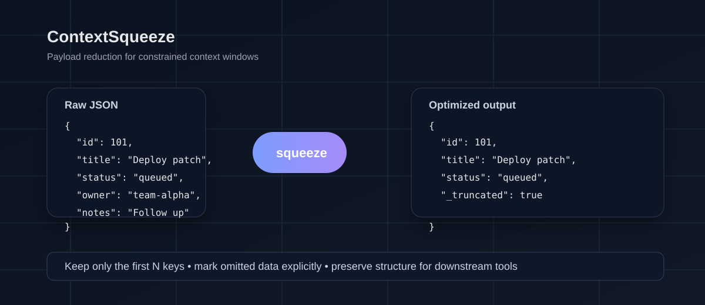

<div align="center">
  
  <h1>ContextSqueeze</h1>
  <p><strong>Trim noisy JSON payloads before they hit the model context window.</strong></p>
  <p>ContextSqueeze keeps only the most relevant fields from each object, adds a clear truncation flag, and helps agent workflows stay lean without losing the shape of the original data.</p>
  <p>
    <a href="#quick-start"></a>
    <a href="#installation"></a>
    <a href="#license"></a>
  </p>
</div>

ContextSqueeze is a small Python utility for reducing large JSON payloads to a more manageable shape. It is designed for LLM and agent workflows where context windows are limited and noisy objects can waste valuable space.

## Why this exists

Large tool responses, telemetry blobs, and extensible JSON payloads often carry far more fields than an agent actually needs. ContextSqueeze addresses that problem by keeping the first N keys from each object and appending a `_truncated` flag when additional data was omitted.

This is intentionally simple and transparent: the output keeps the original structure, preserves the first entries, and makes the truncation explicit for downstream systems.

## At a glance

| Area | Details |
| --- | --- |
| Primary use | Reducing JSON payload size before model context consumption |
| Inputs | JSON files containing objects or arrays of objects |
| Output | Same payload structure with a capped number of keys per object |
| Interface | Command-line tool via `contextsqueeze` |
| Runtime | Python 3.10+ |

## Key capabilities

- Reduces each object to the first `N` keys.
- Adds `_truncated: true` when more data was removed.
- Works directly with JSON files from shell pipelines or local workflows.
- Keeps the change small, explicit, and easy to inspect.
- Fits lightweight toolchains and agent-oriented automation.

## How it works

ContextSqueeze reads a JSON file, iterates over each item in the structure, keeps only the first `--keys` keys, and marks the record as truncated if additional keys existed.

```text
Raw JSON payload
      │
      ▼
ContextSqueeze optimizer
      │
      ▼
Reduced object list with _truncated flag
```

## Installation

Clone the repository and install it in editable mode:

```bash
git clone https://github.com/dntaskmehow/ContextSqueeze.git
cd ContextSqueeze
python -m pip install -e .
```

## Quick start

Create a JSON file and squeeze it down to a smaller payload:

```bash
cat > payload.json <<'JSON'
[
  {
    "id": 101,
    "title": "Deploy patch",
    "status": "queued",
    "owner": "team-alpha",
    "notes": "Follow up in the afternoon",
    "metadata": {"priority": "high"}
  }
]
JSON

contextsqueeze --file payload.json --keys 3
```

Example output:

```json
[
  {
    "id": 101,
    "title": "Deploy patch",
    "status": "queued",
    "_truncated": true
  }
]
```

## Usage

The CLI supports the following arguments:

```bash
contextsqueeze --file path/to/data.json --keys 3
```

- `--file`: required path to the JSON file to optimize.
- `--keys`: optional number of keys to preserve from each object. Default: `3`.

## Configuration and behavior

ContextSqueeze is intentionally conservative:

- It does not rename keys.
- It does not infer semantic importance.
- It does not perform deep recursive optimization.
- It simply keeps the first `N` keys and records that the result was shortened.

This makes the behavior predictable and easy to inspect in debugging and automated workflows.

## Technical details

The package is intentionally small and centered on one core component:

- `src/contextsqueeze/optimizer.py`: contains `ContextOptimizer.squeeze_payload()`
- `src/contextsqueeze/cli.py`: exposes the `contextsqueeze` command-line entry point
- `src/contextsqueeze/__init__.py`: exports package version metadata

The optimizer function operates as a straightforward filter over JSON objects:

```python
from contextsqueeze.optimizer import ContextOptimizer

optimized = ContextOptimizer.squeeze_payload(data, max_keys=3)
```

## Project status

This repository is a focused, minimal utility rather than a broad platform. The current implementation is intentionally narrow: it prioritizes transparent JSON reduction and straightforward CLI usage over more elaborate optimization rules.

Future work could include smarter retention strategies, schema-aware trimming, or richer output signals, but the project’s present scope is intentionally small and easy to reason about.

## Contributing

Contributions are welcome in the form of issues, pull requests, or usage feedback.

1. Fork the repository.
2. Create a feature branch.
3. Make a focused change.
4. Open a pull request with a clear explanation of the problem and the fix.

## Security and responsible use

ContextSqueeze is a utility for payload shaping and context management. It does not validate or sanitize data beyond the JSON parsing and key reduction it performs. Use it with awareness of the upstream data source and the downstream consumer.

## License

The package metadata declares the project under the MIT license.

## Acknowledgments

This project is built as a lightweight utility for context optimization workflows. It is meant to be easy to inspect, easy to use, and easy to adapt in agent and tool pipelines.

---

<div align="center">
  <sub>ContextSqueeze helps keep tool outputs compact, explicit, and suitable for constrained model context windows.</sub>
</div>
